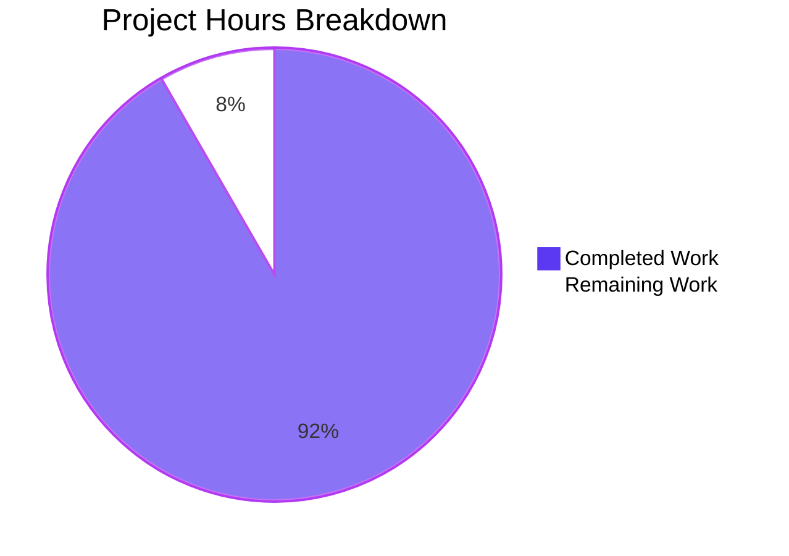

# 1. Executive Summary

Two standard-library Python scripts at the repository root — one deciding whether the integer it holds is prime, one reporting both real square roots of that same number — complete and verified, with a portability claim unexercised and two records still to reconcile.

## 1.1 Project Overview

`prime_check.py` and `sqrt_check.py` are two self-contained Python 3 tools at the repository root. The first decides whether the integer it holds is prime and prints that verdict on one line; the second reports both real square roots of the same number on one line. Each takes its subject from a module-level literal, `n = 97`, so the first prints `97 is prime` and the second `The square roots of 97 are 9.848857801796104 and -9.848857801796104`, each exiting 0. They serve anyone in this checkout who wants a one-line answer from a terminal. The scope is deliberately narrow: two files of 16 counted lines each, one standard-library import, no functions, classes or error handling, no external input, and no dependency of any kind.

## 1.2 Completion Status

Completed work is Dark Blue (#5B39F3); remaining work White (#FFFFFF). **Overall completion: 91.7%.**


| Metric | Value |
|---|---|
| Total Hours | 24.0 |
| Completed Hours (AI + Manual) | 22.0 |
| Remaining Hours | 2.0 |
| Completion | 91.7% |

Calculation: 22.0 ÷ (22.0 + 2.0) × 100 = 91.7%.

## 1.3 Key Accomplishments

- One standard-library file deciding primality by trial division to the integer square root, with its inclusive bound proven on prime squares.
- A second standard-library file reporting both real square roots of 97 on one line, the principal root first and its exact negation second.
- Two independent scripts: neither imports the other, and each prints exactly one line and exits 0.
- Verdict contract: `97 is prime` — one line, 12 bytes, empty standard error, exit 0.
- Both reported roots verified true, each squaring back to 97, with the integer floor root correctly absent.
- 286 subjects compared against independent expectations with no mismatch.
- Both files 16 counted lines inside the 15-to-20 band, one `import math`, module body only.
- Subject source inert to arguments, standard input, environment and working directory; output deterministic; the whole-package gate passes for both.

## 1.4 Critical Unresolved Issues

**3 of 35 scoped requirement units carry an open caveat.** Both parts of the delivery — the primality verdict and the square-root report in its own file — are complete, and no requirement unit is unresolved.

| Issue | Impact | Owner | ETA |
|---|---|---|---|
| The stated CPython 3.8+ portability floor has not been exercised on an interpreter of that vintage; the host provides only CPython 3.13.7 | Medium — the claim rests on the scripts' version surface rather than on a run | Maintainer / release reviewer | 1.0 h |
| The recorded interpreter version and the recorded name of the pre-existing root file describe a different checkout | Low — a reader following them looks for an interpreter and a file that are not here; no functional consequence | Release reviewer | 0.5 h |
| The published whole-package gate asserts the line band and single-import invariants for the primality script only | Low — the square-root script's invariants could drift unnoticed | Maintainer | 0.5 h |

## 1.5 Access Issues

No access issues identified. Neither script needs a credential, service, database, port or third-party access.

## 1.6 Recommended Next Steps

1. **[High]** Confirm the CPython 3.8+ portability floor on an interpreter of that vintage (1.0 h).
2. **[Medium]** Reconcile the recorded environment and repository description with the delivered tree (0.5 h).
3. **[Medium]** Publish the validated invocation, exit-status contract and recorded subject boundaries for both scripts, and extend the recorded gate so it asserts the square-root script's invariants (0.5 h).
4. **[Low]** Note in the handover that the divisor walk is O(√n) — an 18-digit subject takes about 55 seconds — and that each file holds its subject independently, so a subject change must touch both.

# 2. Project Hours Breakdown

Hours below cover only the work this project scoped — the two scripts at the repository root, their verification, and the path-to-production activities that follow from their claims. Nothing outside that scope is counted.

## 2.1 Completed Work Detail

| Component | Hours | Description |
|---|---|---|
| Primality deliverable implementation | 4.0 | `prime_check.py`: its single import, the literal subject, the verdict seed, the divisor walk bounded inclusively by `math.isqrt(n) + 1` with its early exit, and the one printed verdict line — composed to an exact 8 code / 5 comment / 3 blank budget inside the 15-to-20 counted-line band, with each comment block carrying one job. |
| Primality-decision validation | 5.0 | Oracle cross-checking of the decision across the value domain: every integer from 0 to 250, prime squares to 999,966,000,289, Carmichael composites, semiprimes, a 15-digit prime and 2⁵³+1 — 274 subjects executed, 0 mismatches. |
| Verdict-output and runtime validation | 4.0 | The output contract and the non-functional requirements: acceptance runs with byte and line inspection, exit statuses, empty standard error, argument / standard-input / environment / working-directory independence, repeated-run and isolated-interpreter runs, and wall-clock timing. |
| Static quality, composition and rule-compliance review | 3.0 | The form and quality requirements: single-file and import-surface checks, the AST census, line and byte hygiene, per-comment verdicts, and confirmation that no excluded construct is present. |
| Acceptance, integration and delivery verification | 2.0 | The delivery guarantees: syntax check, whole-tree compile, the whole-package gate, and tree-state and blob verification showing that no path other than the deliverable was created, modified or deleted. |
| Square-root deliverable implementation | 2.0 | `sqrt_check.py`: its own literal, the root computation and the single report line carrying both real roots, composed to 16 counted lines (4 code / 7 comment / 5 blank) with each comment block carrying one job. |
| Square-root capability and two-script integration verification | 2.0 | The exact output line, the numeric truth of both roots, the subject's provenance, the file's shape and import surface, the recorded boundary, and the checks showing the two scripts are independent and the tree holds exactly the expected paths. |
| **Total** | **22.0** | |

## 2.2 Remaining Work Detail

| Category | Hours | Priority |
|---|---|---|
| Confirm the stated CPython 3.8+ portability floor on an interpreter of that vintage (the plan's non-functional portability requirement) | 1.0 | High |
| Reconcile the recorded environment and repository description with the delivered tree — the interpreter version recorded for this environment and the name recorded for the pre-existing root file (path to production) | 0.5 | Medium |
| Publish the validated invocation, exit-status contract and recorded subject boundaries for both scripts, and extend the recorded whole-package gate so it asserts the square-root script's line band and single-import invariants (path to production) | 0.5 | Medium |
| **Total** | **2.0** | |

The absent test suite, dependency manifest, packaging metadata, configuration, CI workflow, container definition and linter configuration are requirements of this delivery rather than gaps: each was excluded by name, and creating any of them would breach the delivery's constraints instead of completing the work. They therefore carry no remaining hours.

# 3. Test Results

The project configures no test framework and no coverage tool, so verification is by direct execution of the shipped scripts against independent expectations and by the project's published whole-package gate. Every row below was executed and its result observed; counts are per category.

| Area / Category | Framework | Tests | Passed | Failed | Coverage | What This Proves |
|---|---|---|---|---|---|---|
| Primality decision — value domain | None; direct execution of the shipped module against an independent oracle | 274 | 274 | 0 | n/a — no coverage tool configured | Every subject's verdict is correct: all integers 0–250, prime squares to 999,966,000,289, Carmichael composites, semiprimes, a 15-digit prime and 2⁵³+1. |
| Acceptance and output contract — both scripts | None; process-level execution | 7 | 7 | 0 | n/a | Each script prints exactly its one documented line, with empty standard error and exit 0, for the subject it holds. |
| Square-root value correctness | None; direct execution against recomputed values | 13 | 13 | 0 | n/a | Both reported roots are true: each squares back to 97, the principal root is reported first and its exact negation second, and the integer floor root is not reported. |
| Length, composition and import surface | None; shell and interpreter inspection | 10 | 10 | 0 | n/a | 16 counted lines each (8 code / 5 comment / 3 blank and 4 code / 7 comment / 5 blank), one import line each, `math` inside the standard library, module body only, and no cross-reference between the files. |
| Subject-source inertness | None; process-level execution | 14 | 14 | 0 | n/a | The in-file literal is the only input — four argument forms, piped standard input, an altered environment and a foreign working directory all leave the output byte-identical. |
| Determinism and repeatability | None; direct execution | 2 | 2 | 0 | n/a | Five consecutive runs of each script produce one distinct output line. |
| Recorded negative-subject boundary | None; direct execution of copies | 2 | 2 | 0 | n/a | A negative subject exits 1 with no output and the recorded error on each script, deliberately unguarded. |
| Compile, isolated interpreters, gate and tree state | None; interpreter compile plus shell assertions | 10 | 10 | 0 | n/a | Both scripts compile cleanly, run identically under `-S` and `-I`, satisfy the whole-package gate, and leave the tree with no byte-code and no new path. |
| **Total** | | **332** | **332** | **0** | | |

### Not Covered

- **The CPython 3.8 to 3.12 portability range.** No interpreter below CPython 3.13.7 exists in this environment, so the stated floor is supported by the scripts' version surface — the integer square root entered the standard library in 3.8, and nothing either script needs is newer — rather than by a run. A human should execute the syntax check, the acceptance runs and the reference subjects on the oldest interpreter they intend to support.
- **No committed regression net exists.** The project ships no test file, no test framework and no CI, so a future edit to either script has nothing that runs automatically to catch a mistake; correctness is judged by the run's output. Anyone changing a script should re-run the value-domain sweep and the reference subjects.
- **Out-of-contract invocation forms are recorded, not guaranteed.** Direct execution of either file exits 126 because neither has a shebang and both are mode 644; a consumer that closes standard output before the write ends in CPython's own flush failure with exit 120; and a non-integer, negative or zero subject ends in a raw interpreter error or a mathematically meaningless answer. A human should confirm none of these is expected in the intended use.
- **Everything either script does on its documented path is covered.** The gaps above are an unexercised portability claim, an absent regression net and non-goals outside the contract — not untested behaviour of the shipped code paths.

# 4. Runtime Validation & UI Verification

Neither script has a user interface, an API surface, a network listener or an external integration, so there is no screen, endpoint or third-party service to drive. What follows is the runtime validation of their one observable surface: a process that prints one line and exits.

- ✅ **Startup — primality script** — `python3 prime_check.py` prints `97 is prime` (12 bytes, one line, single trailing newline), writes nothing to standard error, and exits 0.
- ✅ **Startup — square-root script** — `python3 sqrt_check.py` prints `The square roots of 97 are 9.848857801796104 and -9.848857801796104` (68 bytes, one line), writes nothing to standard error, and exits 0.
- ✅ **Startup from a foreign working directory** — either file invoked by absolute path from an unrelated directory produces byte-identical output and exit 0, and leaves that directory empty.
- ✅ **Primality decision across the value domain** — 274 subjects executed, every verdict matching an independent oracle; prime squares, Carmichael composites, a 15-digit prime and 2⁵³+1 all correct.
- ✅ **Reported roots are the true roots** — each value squares back to 97 (residual 1.42e-14), the principal root is reported first and its exact negation second, and the integer floor root is absent; 12 further subjects on copies reproduce their independently recomputed line exactly.
- ✅ **Subject source** — the in-file literal is the only input: four argument forms including a shell-injection payload and a help flag, piped standard input, an altered environment and a foreign working directory all leave the output byte-identical with exit 0 and empty standard error.
- ✅ **Determinism and side-effect freedom** — five consecutive runs of each script produce one distinct output line, and no run creates, modifies or deletes any file; the working tree stays clean and no byte-code is left in the checkout.
- ✅ **Recorded boundary (outside the contract, by design)** — a negative subject exits 1 with no output, raising from the root computation in one script and from the integer square root in the other; no guard was added to either file.
- ✅ **Isolated interpreters and the whole-package gate** — both scripts run byte-identically under `-S` and `-I`, and the gate prints both lines followed by `GATE-OK` with exit 0.
- ⚠ **Two surfaces were never exercised** — the CPython 3.8 to 3.12 portability range, because no older interpreter exists in this environment and the floor is verified from the scripts' version surface only; and any external integration, because neither script opens a file, socket or subprocess, so no endpoint, service, database or queue exists to drive and none is outstanding.

# 5. Compliance & Quality Review

Each scoped deliverable is shown at the state it stands in now, with the benchmark it is measured against and the evidence for that verdict. Where a gap remains it is recorded under 5.2 rather than folded into a pass.

## 5.1 Compliance Matrix

| Deliverable / Benchmark | Verified Status | Progress | Evidence |
|---|---|---|---|
| Two-script delivery — the two Python files at the repository root, and no other path created, updated or deleted | ✅ Pass | 100% | The version-control diff against the base adds `prime_check.py` and `sqrt_check.py` and nothing else (32 insertions); the pre-existing `README.md` keeps its blob. |
| Primality decision — prime exactly when the subject exceeds 1 and has no exact divisor in 2..isqrt(n) | ✅ Pass | 100% | `prime_check.py:9-13`; 274 swept subjects matched an independent oracle with 0 mismatches. |
| Inclusive divisor bound — the window must reach isqrt(n) | ✅ Pass | 100% | `range(2, math.isqrt(n) + 1)`; prime squares from 49 to 999,966,000,289 all reported composite. |
| Square-root report — both real roots of the subject on one line, principal root first | ✅ Pass | 100% | `sqrt_check.py:13,16`; observed exactly `The square roots of 97 are 9.848857801796104 and -9.848857801796104`, exit 0, empty standard error. |
| Verdict output contract — exactly one standard-output line naming the number and the verdict, exit 0 | ✅ Pass | 100% | One `print` sink at `prime_check.py:16`; observed 12 bytes, one line, empty standard error, exit 0. |
| Sub-2 boundary — 0 and 1 report not prime through the verdict seed, with no exception | ✅ Pass | 100% | `prime_check.py:9-10`; observed `0 is not prime` and `1 is not prime`, exit 0, empty divisor window. |
| Subject source — the module-level literal, with no argument, standard-input, environment or configuration path | ✅ Pass | 100% | `prime_check.py:4` and `sqrt_check.py:6`; 14 independence runs byte-identical to the baseline. |
| Length and composition — 15 to 20 counted lines per file, one trailing newline each | ✅ Pass | 100% | `wc -l` = 16 for each (8 code / 5 comment / 3 blank, and 4 code / 7 comment / 5 blank); the last byte of each file is a newline. |
| Comment discipline — each comment block earns its place and none restates its own code | ✅ Pass | 100% | Five comment lines in `prime_check.py` doing three jobs and seven in `sqrt_check.py` doing four; a sweep for placeholder, narration and commented-out code found nothing. |
| Import surface and code structure — standard library only, one import line, module body with no functions, classes or error handling | ✅ Pass | 100% | `1:import math` in each; membership in `sys.stdlib_module_names` is True; AST bodies `[Import, Assign, Assign, For, Expr]` and `[Import, Assign, Assign, Expr]` with 0 function, class or try nodes and no docstring. |
| Independence and determinism — neither file references the other, and each run is one repeatable line | ✅ Pass | 100% | No code reference in either direction; five consecutive runs of each script produced one distinct line. |
| Security posture — no external input, filesystem, network or credential access | ✅ Pass | 100% | No input mechanism, no output sink other than standard output, and no path access, deserializer or cryptographic call in either file; the single import in each is `math`. |

## 5.2 AAP & Rule Divergences and Gaps

Eight divergences were identified. Each is a departure from what the plan specified or from the rules that bind it, and no divergence was left unsettled. Five are marked **Sanctioned** — three because the user directed the change, and two because the instruction and the plan exclude the behaviour by name.

| What the AAP/Rule Required | What Was Delivered Instead | Why It Diverged | Impact | Remediation |
|---|---|---|---|---|
| One Python file at the repository root, and no file other than it created, updated or deleted (core vision FR3, the tree diagram, the "Every second file" exclusion, the one-row file map) | Two source files: `prime_check.py` and the new `sqrt_check.py` | **Sanctioned** — the user's follow-up instruction directed a new file for the added capability, and that instruction outranks the plan | The plan's one-file inventory no longer describes the tree; nothing beyond the two scripts was created, updated or deleted | None; both files are the directed shape |
| The product's whole scope fixed at primality (core vision, the in-scope list, and the exclusion of "any general number-theory helper") | Square-root reporting for the same subject, in the second file | **Sanctioned** — the user extended the scope by instruction | One capability added; the primality work is unchanged and still verified | None |
| One file delivered in a single code block, restated as "exactly one file" (attachment constraint A1, the delivery form, the quality standard) | Two files and two independent runs | **Sanctioned** — directed by the user's instruction, and for the file count only | The per-file discipline still binds both files and both meet it: code alone, 15–20 counted lines, one import, no functions or classes or error handling, one trailing newline | None |
| "Update the python script" — the instruction's own first clause, read against the script's single-purpose statement | The capability delivered in the new file, with `prime_check.py` byte-identical to the pre-delivery tree | The instruction's more specific clause ("Create a new file for this") governs; adding the capability to the existing script would add a second output line, breaching its one-line contract and its 16-line composition | The existing script keeps its verified contract; a reader must not read it as an unfinished update | None; the untouched file is the directed outcome |
| An automated suite behind each delivered capability, and an installed linter run over each changed file | No test file, no framework, no linter run — verification by 332 direct executions against independent expectations, plus read-only static analysis (byte-compile, AST parse, tokenizer, `tabnanny`, warnings-as-errors compile, line-length and whitespace inspection) | **Sanctioned** — tests and any second artefact are excluded by name, and no linter is installed or configured in this project | No automated regression net exists, so a future edit is caught only by re-running the recorded checks | Accept as the delivery's own design; re-run the checks in Section 3 and Section 9 after any edit |
| Error handling excluded by name, with the negative-subject raise recorded as intended behaviour | The same unguarded shape in the new file: a negative literal raises `ValueError: math domain error`, exit 1, no output; 0 and 1 print integer-valued floats | **Sanctioned** — the exclusions bind the new file too, and the contract covers the shipped subject alone | Neither script is a general-purpose utility; a maintainer who re-points a literal meets a bare traceback | Keep the subject 97, or raise a new request; the handover note in Section 2.2 records the boundary |
| The published verification: the whole-package gate and the four quality-standard checks, applied to what the project delivers | The recorded gate asserts the line band and single-import invariants for `prime_check.py`; the same assertions applied to `sqrt_check.py` pass, but the published command does not name it | The gate predates the second script and the follow-up instruction did not extend it | The new script's invariants could drift unnoticed | Extend the recorded gate so both scripts are asserted (0.5 h, Section 2.2) |
| The environment recorded as running Python 3.12.3, and the pre-existing root file recorded as `metering-inventory.md` | Verified on CPython 3.13.7, the only interpreter present; the pre-existing root file here is `README.md`, 47 bytes, blob unchanged | Those records were written against a different host and checkout, and nothing in either script depends on either fact | A reader following the records looks for an interpreter and a file that are not here, and the portability floor rests on the version surface rather than a run | Reconcile the records (0.5 h) and exercise the floor on an older interpreter (1.0 h) — both in Section 2.2 |

**A second source file at the root.** The plan's file map, its tree diagram and its one-file guarantee all describe a single script, and the request that followed directed that the square-root capability be delivered as a new file — an instruction that outranks the plan. `sqrt_check.py` therefore sits beside `prime_check.py`, which stays byte-for-byte identical: its diff against the pre-delivery tree is empty. The consequence is structural rather than functional. The plan's one-file inventory no longer describes the tree, while the guarantee that nothing beyond the expected paths is created, updated or deleted holds exactly, as `git diff --name-status` against the base shows: three paths added, none modified, none deleted.

**The product's scope extended.** The plan fixes the product's whole scope at primality: its vision statement, its in-scope list and its explicit exclusion of "any general number-theory helper" all read that way, and reporting square roots falls outside them. The user's follow-up instruction extended the scope, and it is the higher source. The delivered capability is narrow and exact — both real square roots of 97 on one line, the principal root first and its negation second (`sqrt_check.py:13,16`), each value squaring back to 97 within 1.42e-14 — and it leaves the primality work untouched. A reader comparing the plan's scope statement with the tree will find one extra capability; that is the directed change, not scope creep.

**Two files instead of one.** The plan also fixes the delivery form: one file, handed over in a single code block, with "exactly one file" restated among its quality standards. The follow-up instruction supersedes that form for the file count alone, and the qualification matters: every per-file value the instruction did not touch still binds both files, and both meet it — content that is code alone with no fence, heading, prose or docstring; 15 to 20 counted lines counting comments and blanks; `import math` as the only import line; no function, class, `try`/`except` or other error handling; and exactly one trailing newline. What ships is two independent single-line commands rather than one artifact, and each was executed and its output compared byte for byte.

**Where the capability landed.** The instruction's first clause reads "Update the python script", which taken alone points at `prime_check.py`; its second clause directs a new file, and the two cannot both be satisfied. The reading taken places the capability in the new file and leaves `prime_check.py` exactly as it was. The alternative would have broken the existing script's contract twice over: its one-line output would gain a second line, and its 16-line composition and single-purpose statement would no longer hold. `prime_check.py` is therefore not an unfinished update — it is the file the instruction required be left alone, and its blob is identical to the pre-delivery tree.

**No test suite and no linter run.** The instruction and the plan's own exclusions agree: no test file, no test framework, no dependency manifest, no configuration and no packaging metadata may be added, and the verification steps call for an installed linter that neither this project nor its toolchain provides. Verification is therefore by direct execution — 332 executions compared against independent expectations — together with read-only static analysis using only the interpreter and its standard library: a byte-compile, an AST parse, a tokenizer pass, `tabnanny`, a compile with warnings promoted to errors, and line-length and whitespace inspection. The consequence is real and worth carrying forward: there is no regression net, so a future edit is caught only by re-running those checks.

**Unguarded subjects other than 97.** Both scripts leave subjects other than 97 unguarded, because error handling, argument parsing and validation are excluded by name and the contract covers the shipped literal alone. On `sqrt_check.py` a negative literal raises `ValueError: math domain error` at line 13, exits 1 and prints nothing; on `prime_check.py` the same shape is the boundary the design records — `ValueError: isqrt() argument must be nonnegative`, exit 1, no output. A literal of 0 or 1 on the square-root script prints mathematically meaningless roots (`0.0 and -0.0`, `1.0 and -1.0`). This is correct as directed, and it means neither script is a general-purpose utility: a maintainer who re-points a literal meets a bare traceback with nothing in the file to explain it.

**The published gate covers one script.** The project's published whole-package gate — compile the tree, run the script, assert the 15-to-20 line band, assert exactly one import line and that it is `import math` — names `prime_check.py` only. The same assertions applied to `sqrt_check.py` pass, so the script's current state is sound; what is missing is the automation, which means a later edit to the new file could slip past the published check unnoticed. The gap exists because the gate was written before the second script, and the follow-up instruction did not extend it. Closing it costs half an hour and needs no new file, since the gate is a command: extend the recorded command so both scripts are asserted.

**Two recorded facts that describe a different checkout.** The environment is recorded as running Python 3.12.3, while the interpreter present here reports 3.13.7 and is the only one installed; and the pre-existing root file is recorded as `metering-inventory.md`, while the tree holds `README.md`, 47 bytes, byte-identical to the initial commit. Those records were written against a different host and checkout, and nothing in either script depends on them — the only version-sensitive capability in the pair is the integer square root, which entered the standard library in 3.8. A reader following the records therefore looks for an interpreter and a file that are not here, and the portability floor rests on the version surface rather than on a run.

# 6. Risk Assessment

Risks below are forward-looking: what could still go wrong once these scripts are in use.

| Risk | Category | Severity | Probability | Mitigation | Status |
|---|---|---|---|---|---|
| No committed regression net exists, so a future edit to either script has nothing that runs automatically to catch a mistake | Technical | Medium | High | Re-run the value-domain sweep, the reference subjects and the whole-package gate after any change; the checks are recorded in Section 3 and Section 9 | Open — follows the delivery's exclusion of tests |
| The divisor walk is O(√n) over every integer in the window with no even-divisor skip, so re-pointing the literal at a very large prime reads as a hang (an 18-digit subject takes about 55 seconds as a process) | Technical | Medium | High | Keep the subject small — the shipped literal costs eight candidate tests and 13 ms — or raise a new request for a skipping or probabilistic algorithm | Open |
| The stated CPython 3.8+ portability floor is supported by the scripts' version surface rather than by a run | Technical | Medium | Medium | Execute the syntax check, the acceptance runs and the reference subjects on the oldest interpreter you intend to support (1.0 h) | Open |
| The two files hold the same subject independently, so a subject change must touch both and nothing automatic would catch the drift | Technical | Medium | Medium | Change both literals together; the independence is deliberate, since importing one from the other would print a second output line | Accepted — by design |
| The published whole-package gate asserts one script's invariants only, so the square-root script's line band and single-import invariants could drift unnoticed | Operational | Low | Medium | Extend the recorded gate so both scripts are asserted (0.5 h, Section 2.2) | Open |
| The recorded interpreter version and the recorded name of the pre-existing root file describe a different checkout, so a reader following them looks for an interpreter and a file that are not here | Operational | Low | Medium | Reconcile the records with the delivered tree (0.5 h, Section 2.2) | Open |
| Off-contract use of either script — direct execution (no shebang, mode 644, exit 126), a consumer that closes standard output (exit 120), or importing the module (which prints a line and leaves byte-code in a tree with no ignore file) | Operational | Low | Low | Use the documented invocation, `python3 <file>.py`; point `PYTHONPYCACHEPREFIX` outside the checkout if you import | Accepted — outside the contract |
| The float route bounds fidelity outside the shipped subject: perfect squares print integer-valued floats, and far above 2⁵³ the last digits of a reported root degrade | Integration | Low | Low | Keep the subject within double precision, or raise a new request for a symbolic route | Accepted — the float route is the only one that yields a root of the prime 97 |

No security risk is identified at any severity. Neither script takes external input, opens a file, talks to a network, holds a credential or writes anything but one line to standard output; that absence was verified rather than assumed, by reading both files in full and by 14 runs in which arguments, standard input, environment and working directory were each shown inert. No external integration exists either — there is no service, endpoint, database, queue, port or container in this project — so no missing-integration risk arises at any severity.

# 7. Visual Project Status

Completed work is shown in Dark Blue (#5B39F3); remaining work in White (#FFFFFF). **Overall completion: 91.7%.**



**Remaining hours by category**

| Category | Hours | Priority |
|---|---|---|
| Confirm the stated CPython 3.8+ portability floor on an interpreter of that vintage | 1.0 | High |
| Reconcile the recorded environment and repository description with the delivered tree | 0.5 | Medium |
| Extend the recorded whole-package gate to cover both scripts, and publish the validated invocation, exit-status contract and recorded boundaries | 0.5 | Medium |
| **Total** | **2.0** | |

**Priority distribution of remaining work**

| Priority | Hours | Share of remaining work |
|---|---|---|
| High | 1.0 | 50.0% |
| Medium | 1.0 | 50.0% |
| Low | 0.0 | 0.0% — advisory only, no additional work |

# 8. Summary & Recommendations

**What was delivered.** Two self-contained standard-library Python 3 scripts sit at the repository root. `prime_check.py` decides whether the integer it holds is prime by trial division to the integer square root and prints that verdict on one line; `sqrt_check.py` reports both real square roots of the same number on one line, the principal root first and its exact negation second. Each is 16 counted lines inside the 15-to-20 band, each imports `math` and nothing else, each defines no function, class or error path, and each takes its subject from the module-level literal `n = 97`, so the first prints `97 is prime` and the second prints `The square roots of 97 are 9.848857801796104 and -9.848857801796104`, each with exit 0 and empty standard error. All 35 scoped requirement units are accounted for — 32 complete and 3 carrying an open caveat — and the project stands at **91.7% complete — 22.0 completed hours of 24.0 total** — with the remaining two hours covering one unexercised claim and two records to reconcile rather than any missing functionality.

**What was exercised to prove it works.** 332 executions were observed first-hand, with no failures. The primality decision was validated over 274 subjects — every integer from 0 to 250, prime squares to 999,966,000,289, Carmichael composites, semiprimes, a 15-digit prime and 2⁵³+1 — each verdict compared against an independent oracle with 0 mismatches; that is what proves the inclusive `math.isqrt(n) + 1` bound rather than merely asserting it. The square-root capability was confirmed on 13 subjects whose printed lines were recomputed independently, with both reported values squaring back to 97 and the integer floor root correctly absent. Both output contracts were confirmed byte by byte — one line each, no standard error, exit 0. The subject source was shown inert across arguments, standard input, environment and working directory; five consecutive runs of each script produced one distinct line; both scripts ran byte-identically under isolated and site-free interpreters; and the whole-package gate printed `GATE-OK` with exit 0 while leaving the tree clean of byte-code.

**What remains open.** Three items make up the two remaining hours. The CPython 3.8+ portability floor is supported by the scripts' version surface — the integer square root entered the standard library in 3.8, and nothing either script needs is newer — but has never been exercised on an interpreter of that vintage, because none exists in this environment (1.0 h, the only remaining item that touches a behavioural claim). The recorded interpreter version and the recorded name of the pre-existing root file describe a different checkout and need reconciling with the tree (0.5 h). And the published whole-package gate asserts the line band and single-import invariants for one script only, so it should be extended to cover both (0.5 h). Eight divergences are recorded in Section 5.2, five of them sanctioned by the instruction and the plan itself, and none of them changes what either script does.

**Critical path to production.** The project is two self-contained scripts with no service to deploy, no dependency to install, no configuration to supply and no integration to provision, so the path is short and entirely verification-shaped: run the syntax check, the acceptance runs and the reference subjects on the oldest interpreter you intend to support; reconcile the two recorded facts with the tree; and extend the recorded gate and handover notes so the invocation, the exit-status contract and the recorded subject boundaries of both scripts travel with the code. Everything that would normally sit on a path to production — packaging, CI, monitoring, secrets, infrastructure — is excluded by the delivery's own constraints rather than outstanding.

**Success metrics and readiness.** Against what this project set out to deliver, every measure is met: two files, 16 lines each, one import each, one printed line each, exit 0, deterministic output, no side effects on the tree, no access requirements and no open defect. Judged against the plan's own classification of a throwaway utility, the pair is ready for its purpose and correct on every path a user of the documented invocation can take. It is deliberately not production-ready as a general-purpose tool: the subjects are hard-coded, there is no input handling, validation or error surface, and neither script should be presented as a general primality or square-root calculator. The recommendation is therefore to close the portability confirmation and the two record items, then hand the pair over as it stands, with Section 3's checks recorded as the manual verification to repeat after any future edit.

# 9. Development Guide

Every command below was executed from the repository root and its output observed.

### System Prerequisites

- **CPython 3.8 or later.** The only capability with a version floor is the integer square root, `math.isqrt`, which entered the standard library in 3.8; the square-root script needs nothing newer than `math.sqrt`, which every CPython 3.x provides. Verified here on CPython 3.13.7.
- **No operating-system requirement** beyond something that can run CPython: neither script reads a file, opens a socket or touches a device.
- **No hardware requirement.** The shipped primality subject costs eight divisor tests and a run completes in about 13 milliseconds, almost all of it interpreter start-up.

```bash
python3 --version        # expect: Python 3.13.7 (any 3.8+ works)
```

### Environment Setup

Nothing to set up. There is no virtual environment to create, no dependency to install, no service to start, no port, no database and no credential. The single import in each file ships inside CPython.

```bash
cd "$(git rev-parse --show-toplevel)"   # the repository root
```

Do not install into the system interpreter: it is externally managed, and the project declares no dependency to install anyway.

### Dependency Installation

None. Both scripts import `math` and nothing else; there is no `requirements.txt`, `pyproject.toml`, `setup.py`, `Pipfile`, lock file or `package.json` in the tree, and none is needed.

### Application Startup

```bash
python3 prime_check.py    # expect: 97 is prime
python3 sqrt_check.py     # expect: The square roots of 97 are 9.848857801796104 and -9.848857801796104
```

Each command prints exactly one line, writes nothing to standard error, and exits 0. The two scripts are independent: neither reads anything the other produces.

### Verification Steps

```bash
# step 0 - a scratch directory for byte-code, kept outside the checkout
pycache=$(mktemp -d)

# step 1 - syntax check
PYTHONPYCACHEPREFIX="$pycache" python3 -m py_compile prime_check.py sqrt_check.py
# expect: no output, exit 0

# step 2 - acceptance runs, with streams inspected
python3 prime_check.py    # 97 is prime                     exit 0, stderr empty, 12 bytes, one line
python3 sqrt_check.py     # the square-roots line            exit 0, stderr empty, 68 bytes, one line

# step 3 - the import in each file is a standard-library module and resolves as expected
python3 -c "import sys, math; print('math in stdlib:', 'math' in sys.stdlib_module_names); print('math.isqrt(97) =', math.isqrt(97)); print('math.sqrt(97) =', math.sqrt(97))"
# expect: math in stdlib: True / math.isqrt(97) = 9 / math.sqrt(97) = 9.848857801796104

# step 4 - the counted line budget and the import surface of each file
wc -l prime_check.py sqrt_check.py                  # expect: 16 prime_check.py, 16 sqrt_check.py, 32 total
grep -nE '^(import|from) ' prime_check.py sqrt_check.py   # expect: 1:import math in each file

# step 5 - whole-package gate: compile, both acceptance runs, both line bands, one import line each
PYTHONPYCACHEPREFIX="$pycache" python3 -m compileall -q . \
  && python3 prime_check.py \
  && test "$(wc -l < prime_check.py)" -ge 15 \
  && test "$(wc -l < prime_check.py)" -le 20 \
  && test "$(grep -cE '^(import|from) ' prime_check.py)" -eq 1 \
  && grep -qx 'import math' prime_check.py \
  && python3 sqrt_check.py \
  && test "$(wc -l < sqrt_check.py)" -ge 15 \
  && test "$(wc -l < sqrt_check.py)" -le 20 \
  && test "$(grep -cE '^(import|from) ' sqrt_check.py)" -eq 1 \
  && grep -qx 'import math' sqrt_check.py \
  && echo GATE-OK
# expect: 97 is prime, then the square-roots line, then GATE-OK, exit 0

# step 6 - no site-packages or user-site dependency
python3 -S prime_check.py ; python3 -I prime_check.py    # expect: 97 is prime from each
python3 -S sqrt_check.py  ; python3 -I sqrt_check.py     # expect: the square-roots line from each
```

To check a different subject, work on a copy outside the checkout — the tracked files are the deliverable, so do not edit them to test a value:

```bash
scratch=$(mktemp -d)

cp prime_check.py "$scratch/prime_copy.py"
sed -i 's/^n = [0-9-]*$/n = 91/' "$scratch/prime_copy.py"
python3 "$scratch/prime_copy.py"    # expect: 91 is not prime

cp sqrt_check.py "$scratch/sqrt_copy.py"
sed -i 's/^n = [0-9-]*$/n = 4/' "$scratch/sqrt_copy.py"
python3 "$scratch/sqrt_copy.py"     # expect: The square roots of 4 are 2.0 and -2.0
```

### Reference Behaviours

`prime_check.py`:

| Subject (`n`) | Expected output | Exit status | Note |
|---|---|---|---|
| 97 | `97 is prime` | 0 | The shipped literal — the acceptance case |
| 2, 3, 7919, 999983, 1000003, 1000033, 2147483647, 999999999989 | `<n> is prime` | 0 | Smallest primes through a 12-digit prime |
| 91 | `91 is not prime` | 0 | Composite control (7 × 13) |
| 49, 121, 289, 841, 961 | `<n> is not prime` | 0 | Prime squares; an exclusive bound would report them prime |
| 9007199254740993 | `9007199254740993 is not prime` | 0 | 2⁵³+1 — composite, divisible by 3 |
| 0, 1 | `0 is not prime`, `1 is not prime` | 0 | Reported not prime through the verdict seed; the divisor window is empty |
| any negative value | no output | 1 | Outside the contract: `ValueError: isqrt() argument must be nonnegative` at the loop head |

`sqrt_check.py`:

| Subject (`n`) | Expected output | Exit status | Note |
|---|---|---|---|
| 97 | `The square roots of 97 are 9.848857801796104 and -9.848857801796104` | 0 | The shipped literal — the acceptance case; the principal root first, its exact negation second |
| 2 | `The square roots of 2 are 1.4142135623730951 and -1.4142135623730951` | 0 | Irrational pair |
| 4, 121 | `The square roots of 4 are 2.0 and -2.0`; `The square roots of 121 are 11.0 and -11.0` | 0 | Perfect squares print integer-valued floats |
| 1 | `The square roots of 1 are 1.0 and -1.0` | 0 | Off-contract subject; the shipped contract covers 97 alone |
| 0 | `The square roots of 0 are 0.0 and -0.0` | 0 | Off-contract subject |
| any negative value | no output | 1 | Outside the contract: `ValueError: math domain error` at `root = math.sqrt(n)` |

The integer floor root is never reported as a square root: `math.isqrt(97)` is 9, and 9² is 81, not 97.

### Example Usage

```bash
$ python3 prime_check.py
97 is prime
$ echo $?
0

$ python3 sqrt_check.py
The square roots of 97 are 9.848857801796104 and -9.848857801796104
$ echo $?
0

$ python3 prime_check.py --help          # arguments are ignored; the subject comes from the file
97 is prime
```

A caller can rely on three things from each script: exactly one line on standard output, nothing on standard error, and exit status 0. Neither reads an argument, standard input, an environment variable or a configuration file, so the same file always produces the same line.

### Troubleshooting

| Symptom | Cause | Resolution |
|---|---|---|
| `python3: command not found` | No CPython on `PATH` | Install CPython 3.8 or later, or invoke the interpreter by absolute path |
| `./prime_check.py: Permission denied` (exit 126) | The file has no shebang and its mode is 644 — it is not an executable script | Invoke it through the interpreter: `python3 prime_check.py` |
| `ValueError: isqrt() argument must be nonnegative` (exit 1, no output) | The subject in `prime_check.py` is negative, which is outside the script's contract and intentionally unhandled | Set the literal to a non-negative integer; a guard is deliberately not present |
| `ValueError: math domain error` (exit 1, no output) | The subject in `sqrt_check.py` is negative, which is outside that script's contract and intentionally unhandled | Set the literal to a non-negative integer; a guard is deliberately not present |
| `TypeError` (exit 1, no output) | A subject line holds a non-integer value such as `97.0` or `"97"` | Make the subject a bare integer literal |
| `SyntaxError` after editing a subject line | The edited line is not valid Python | Restore a form such as `n = 97` |
| `__pycache__` appears in the checkout | A compile or an import wrote byte-code beside the source | Remove it, or point `PYTHONPYCACHEPREFIX` at a directory outside the checkout as the commands above do |
| `Exception ignored on flushing sys.stdout` with exit 120 | The consumer closed standard output before the write; this is CPython's own behaviour for any one-line writer | Use a consumer that reads; each script's contract covers the documented invocation only |
| `wc -l` no longer reports 16 | A file was edited | Keep each file inside the 15-to-20 band; the comment lines are what meet its floor, so trim code rather than comments |
| A run takes minutes instead of milliseconds | The primality literal was re-pointed at a very large prime; the walk is O(√n) with no even-divisor skip, and an 18-digit subject takes about 55 seconds | Restore a small subject, or raise a new request for a different algorithm |
| A reported root loses its last digits | The reported roots are doubles, so fidelity is bounded well above 2⁵³ | Keep the subject within double precision, or raise a new request for a symbolic route |

# 10. Appendices

Supporting references for building, running and maintaining this project. Every command shown was executed and its result observed.

## A. Command Reference

All commands run from the repository root. Set `pycache=$(mktemp -d)` once and pass it as `PYTHONPYCACHEPREFIX` wherever a compile or import would otherwise write byte-code into the checkout.

| Command | Purpose | Expected result |
|---|---|---|
| `python3 --version` | Confirm the interpreter | `Python 3.13.7` (any 3.8 or later works) |
| `python3 prime_check.py` | Run the primality script | `97 is prime`, exit 0, standard error empty, 12 bytes on standard output |
| `python3 sqrt_check.py` | Run the square-root script | The square-roots line, exit 0, standard error empty, 68 bytes |
| `pycache=$(mktemp -d)` | Make a scratch directory for byte-code, outside the checkout | A path is printed |
| `PYTHONPYCACHEPREFIX="$pycache" python3 -m py_compile prime_check.py sqrt_check.py` | Syntax check both files | No output, exit 0 |
| `PYTHONPYCACHEPREFIX="$pycache" python3 -m compileall -q .` | Compile the whole tree | No output, exit 0 |
| `python3 -c "import sys, math; print('math' in sys.stdlib_module_names, math.isqrt(97), math.sqrt(97))"` | Confirm the import is standard-library and both routes resolve | `True 9 9.848857801796104` |
| `wc -l prime_check.py sqrt_check.py` | Counted length of each file | `16 prime_check.py`, `16 sqrt_check.py`, `32 total` |
| `grep -cE '^(import\|from) ' prime_check.py` | Import-line count, primality script | `1` |
| `grep -cE '^(import\|from) ' sqrt_check.py` | Import-line count, square-root script | `1` |
| `grep -nE '^(import\|from) ' prime_check.py sqrt_check.py` | The imports themselves | `1:import math` in each file |
| `grep -cvE '^\s*#\|^\s*$' prime_check.py` | Code-line count, primality script | `8` |
| `grep -cvE '^\s*#\|^\s*$' sqrt_check.py` | Code-line count, square-root script | `4` |
| `python3 -S prime_check.py` and `python3 -I prime_check.py` | Prove no site-packages or user-site dependency | `97 is prime`, exit 0, byte-identical to the plain run |
| `git diff --name-status <base>..HEAD` | Confirm the footprint | `A prime_check.py`, `A sqrt_check.py` and the documentation file, and nothing else |
| `find . -path ./.git -prune -o -type f -print` | List the tree | `./README.md`, the pre-existing documentation file, `./prime_check.py`, `./sqrt_check.py` |
| `git status --porcelain -uall` | Confirm nothing was left behind by a run | No output |

Whole-package gate — compile, both runs, both line bands, one import line each:

```bash
pycache=$(mktemp -d)
PYTHONPYCACHEPREFIX="$pycache" python3 -m compileall -q . \
  && python3 prime_check.py \
  && test "$(wc -l < prime_check.py)" -ge 15 \
  && test "$(wc -l < prime_check.py)" -le 20 \
  && test "$(grep -cE '^(import|from) ' prime_check.py)" -eq 1 \
  && grep -qx 'import math' prime_check.py \
  && python3 sqrt_check.py \
  && test "$(wc -l < sqrt_check.py)" -ge 15 \
  && test "$(wc -l < sqrt_check.py)" -le 20 \
  && test "$(grep -cE '^(import|from) ' sqrt_check.py)" -eq 1 \
  && grep -qx 'import math' sqrt_check.py \
  && echo GATE-OK
```

Subject substitution on a copy outside the checkout:

```bash
scratch=$(mktemp -d)
cp prime_check.py "$scratch/prime_copy.py"
sed -i 's/^n = [0-9-]*$/n = 49/' "$scratch/prime_copy.py"
python3 "$scratch/prime_copy.py"    # expect: 49 is not prime
```

## B. Port Reference

The project binds no port and starts no listener. Neither script has an HTTP, TCP or UDP surface, needs no inbound access and exposes no health endpoint.

| Port | Protocol | Used by | Notes |
|---|---|---|---|
| — | — | — | None. Each script's only input/output channel is standard output, and each exits immediately after writing one line. |

## C. Key File Locations

The repository holds four files. The first two are this project's deliverable.

| Path | Purpose | Notes |
|---|---|---|
| `prime_check.py` | Decides primality of the literal it holds by trial division to the integer square root and prints one verdict line. Run as `python3 prime_check.py`. | Repository root, 526 bytes, mode 644, 16 counted lines (8 code + 5 comment + 3 blank), one import. It declares no callable interface and nothing in the tree imports it. |
| `sqrt_check.py` | Reports both real square roots of the literal it holds on one line, the principal root first. Run as `python3 sqrt_check.py`. | Repository root, 510 bytes, mode 644, 16 counted lines (4 code + 7 comment + 5 blank), one import, and no reference to its sibling in either direction. |
| `README.md` | Pre-existing file at the repository root. | 47 bytes, unchanged: identical blob before and after this work. Outside its scope and deliberately untouched. |
| `blitzy/documentation/Project Guide - 2601e7b0-672c-47e5-8431-7c838e65e3f9.md` | Pre-existing project documentation. | Added before this work's final change and untouched by it. |

Line map of `prime_check.py`:

| Line(s) | Content |
|---|---|
| 1 | `import math` — the only import |
| 2 | blank separator |
| 3 | comment naming the task |
| 4 | `n = 97` — the literal subject, the script's only input |
| 5 | blank separator |
| 6–8 | comment explaining why the divisor walk stops at the integer square root, and why the bound is inclusive |
| 9 | `prime = n > 1` — the verdict seed, already false for 0 and 1 |
| 10–13 | the divisor walk: head, exact-divisor test, verdict set to composite, early exit |
| 14 | blank separator |
| 15 | comment stating the script's sole-output contract |
| 16 | the single `print` of the verdict |

Line map of `sqrt_check.py`:

| Line(s) | Content |
|---|---|
| 1 | `import math` — the only import |
| 2 | blank separator |
| 3–4 | comment naming what the file reports and where its subject comes from |
| 5 | blank separator |
| 6 | `n = 97` — the literal subject, the script's only input |
| 7 | blank separator |
| 8–9 | comment on why both roots are reported and of what kind they are |
| 10 | blank separator |
| 11–12 | comment identifying the principal root and where the second comes from |
| 13 | `root = math.sqrt(n)` — the one computation |
| 14 | blank separator |
| 15 | comment introducing the report line |
| 16 | the single `print` of both roots |

## D. Technology Versions

| Component | Version | Notes |
|---|---|---|
| Language / runtime | CPython 3.8 or later | The floor comes from `math.isqrt`, which entered the standard library in 3.8; the square-root script needs nothing newer than `math.sqrt`. Verified on CPython 3.13.7, the interpreter this environment provides. |
| Standard-library module | `math` (CPython built-in) | Used once in each script, for `math.isqrt(n)` and for `math.sqrt(n)`. Because it is a built-in on this build, a rogue `math.py` beside a script or earlier on `PYTHONPATH` cannot shadow it. |
| Framework | None | No web, test, CLI or dependency framework is used or configured. |
| Database, cache, broker, queue | None | The scripts hold no state beyond the scalars each defines. |
| Third-party packages | None | No manifest, lock file or packaging metadata exists; nothing is installed. |
| Build tooling | None | There is no build step. The syntax check and the whole-package gate are the only automated checks, and both are provided by the interpreter itself. |
| Test framework, linter, type checker, CI | None | Not configured and not required by this project's scope. |

## E. Environment Variable Reference

**Neither script reads an environment variable.** Each subject is the literal on its subject line, and each output is a pure function of that value. The variables below were exercised and confirmed to leave the output byte-identical, with exit 0 and empty standard error.

| Variable | Read by either script | Observed effect |
|---|---|---|
| `N` (or any variable naming a number) | No | None — the output is unchanged |
| `PYTHONPATH` | No | None — the only import is a built-in module and cannot be shadowed |
| `PYTHONWARNINGS` | No | None — a run with warnings promoted to errors is still clean |
| `LC_ALL`, `LANG` | No | None — the output is ASCII and locale-independent |
| `PYTHONHASHSEED` | No | None — nothing is hashed or ordered |
| `PYTHONIOENCODING`, `PYTHONUTF8` | No | None — the output lines are ASCII |
| — (empty environment, `env -i`) | No | None — neither script needs anything from the environment |

`PYTHONPYCACHEPREFIX` is not read by either script; it is a convenience for the commands in Appendix A, pointing the interpreter's byte-code cache outside the checkout so the working tree stays pristine.

## F. Developer Tools Guide

**Interpreter.** Use the system `python3`. Create no virtual environment and install nothing into it: the project declares no dependency, and the system interpreter is externally managed.

**What is not configured, and why.** There is no test framework, no linter, no formatter, no type checker and no CI workflow in this project, and no configuration file for any of them. Their absence is a requirement of the delivery — nothing beyond the two scripts — so any of them would be a further artefact rather than an improvement. Quality checks are therefore run by hand or by your own tools in your own environment.

**Checks available without adding anything.** The static checks below use only the interpreter and its standard library, and all of them are clean on both delivered files:

```bash
python3 -c "import ast, pathlib
files = ('prime_check.py', 'sqrt_check.py')
[ast.parse(pathlib.Path(f).read_text()) for f in files]
print('AST parse clean')"                                          # syntax, in memory

python3 -c "import pathlib, tokenize
files = ('prime_check.py', 'sqrt_check.py')
[list(tokenize.generate_tokens(iter(pathlib.Path(f).read_text().splitlines(True)).__next__)) for f in files]
print('tokenize clean')"                                           # tokenises cleanly

python3 -m tabnanny prime_check.py sqrt_check.py                   # tabs and indentation
python3 -W error -c "import pathlib
for f in ('prime_check.py', 'sqrt_check.py'):
    compile(pathlib.Path(f).read_text(), f, 'exec')
print('warnings-as-errors compile clean')"                         # no warnings

awk 'length($0) > 79 { print FILENAME ": long line " NR }' prime_check.py sqrt_check.py   # PEP 8 line length
```

Use the in-memory forms shown above rather than `py_compile` when you want to leave the tree untouched; if you do compile, set `PYTHONPYCACHEPREFIX` outside the checkout.

**Repeating the behavioural verification.** The value-domain check compares each script's output against an independent implementation, and it is worth re-running after any edit:

1. Copy the file outside the repository and substitute the subject on its `n = …` line — never edit a tracked file to test a value.
2. Obtain the expected answer independently of the method under test: a sieve of Eratosthenes or a deterministic Miller–Rabin test (bases 2 to 37 are valid below 3.3 × 10²⁴) for the primality verdict, and `math.sqrt` recomputation for the root pair.
3. Compare the printed line with the expected one, and treat any difference as a failure of the script rather than of the expectation.
4. For the primality script, include at minimum 0 and 1; the first primes 2 and 3; the composites 4, 9 and 91; prime squares such as 49, 121 and 169 and their larger relatives; and at least one large prime and one semiprime. For the square-root script, include the shipped subject, an irrational pair, a perfect square and a subject whose root is integral but large.

**Inspecting the tree's state.** `git diff --name-status <base>..HEAD` should show the two added scripts and the documentation file and nothing else; `git status --porcelain -uall` should be empty after any run; and `find . -path ./.git -prune -o -type f -print` should list exactly `./README.md`, the pre-existing documentation file, `./prime_check.py` and `./sqrt_check.py`.

## G. Glossary

| Term | Meaning in this project |
|---|---|
| **Primality** | Whether a whole number greater than 1 has no exact divisor other than 1 and itself. |
| **Trial division** | Testing candidate divisors one by one. Here every integer from 2 up to the integer square root of the subject is tested, and the first exact divisor ends the walk. |
| **Integer square root** | `math.isqrt(n)`, the floor of the exact square root of `n`, computed in integer arithmetic so no rounding error can creep in. `math.isqrt(97)` is 9. |
| **Divisor window** | The candidates the walk tests: `range(2, math.isqrt(n) + 1)`. For the shipped subject it is `2..9`, eight candidates. |
| **Inclusive bound** | The `+ 1` that makes the window reach the integer square root itself. It is load bearing: 49 is 7 × 7, so a window stopping at 6 would report it prime. |
| **Prime square** | A number of the form k² where k is prime — 49, 121, 169 and their larger relatives. These are the cases the inclusive bound catches. |
| **Composite** | A whole number greater than 1 that has an exact divisor other than 1 and itself; the primality script reports it as `not prime`. |
| **Carmichael number** | A composite that passes some probabilistic primality tests; trial division is not fooled by it, and several were included in the verification. |
| **Principal root** | The nonnegative square root of a number, which is what `math.sqrt` returns. The square-root script reports it first and its negation second. |
| **Float route** | Obtaining the roots through `math.sqrt`, which returns a double. It is the only route that produces a root of 97: the number is prime, so neither root is an integer, and `math.isqrt(97)` is the floor of the root rather than a root. |
| **Literal subject** | The number a script judges, held in the module-level assignment on its subject line (`n = 97`). It is that script's only input — no argument, standard input, environment variable or configuration feeds it. |
| **Verdict seed** | `prime = n > 1`, the primality script's initial answer. Because it is already false for 0 and 1, those two come out `not prime` through the seed rather than through a special case. |
| **Module body** | Statements run top to bottom when the file is executed. Neither script defines a function, class, `__main__` guard or callable interface. |
| **Counted line** | A line of a file as `wc -l` counts it — code, comment and blank alike. Each file must stay between 15 and 20; both are 16. |
| **Independence** | Neither script imports, calls or references the other. Each holds its own copy of the subject, so a subject change must be made in both files. |
| **Oracle** | An independent implementation used to compute the expected answer, so a script's result is not checked against itself. A sieve and a Miller–Rabin test were used here. |
| **Whole-package gate** | The project's published acceptance check: compile the tree, run each script, assert each line band, assert exactly one import line per script and that it is `import math`. It prints `GATE-OK` when all of that holds. |
| **Exit status contract** | Exit 0 and exactly one line on standard output for a non-negative subject; exit 1 with no output for a negative one, which is outside the contract by design. |
