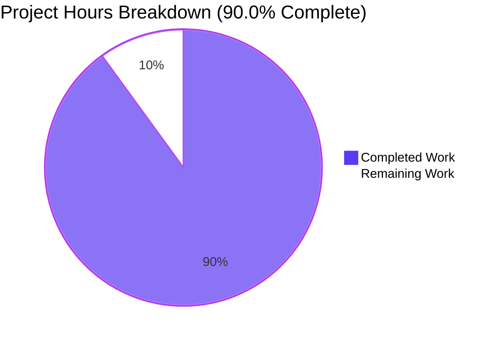
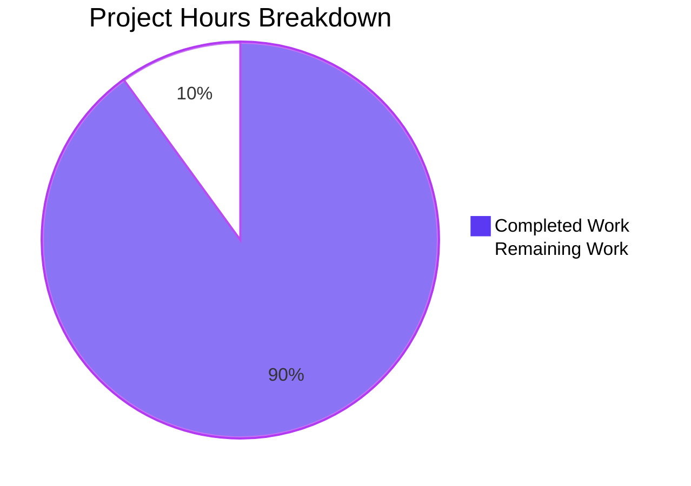

# 1. Executive Summary

One standard-library Python file that reports whether the integer it holds is prime — complete, verified against an independent oracle, with one portability claim and two records open.

## 1.1 Project Overview

`prime_check.py` is a single-file Python 3 tool at the repository root that decides whether the integer it holds is prime and prints that verdict on one line of standard output. Its subject is the module-level literal `n = 97`, so a run prints `97 is prime` and exits 0. It serves anyone in this checkout who wants a one-line answer to "is this number prime" from a terminal.

The scope is deliberately narrow: one file of 16 counted lines, one standard-library import, no functions, classes or error handling, and no external input.

## 1.2 Completion Status

Completed work is Dark Blue (#5B39F3); remaining work White (#FFFFFF). **Overall completion: 90.0%.**



| Metric | Value |
|---|---|
| Total Hours | 20.0 |
| Completed Hours (AI + Manual) | 18.0 |
| Remaining Hours | 2.0 |
| Completion | 90.0% |

Calculation: 18.0 ÷ (18.0 + 2.0) × 100 = 90.0%.

## 1.3 Key Accomplishments

- One standard-library file deciding primality by trial division to the integer square root.
- The inclusive `math.isqrt(n) + 1` bound, verified on prime squares up to 999,966,000,289.
- Exactly one stdout line naming the number and its verdict: 12 bytes, empty stderr, exit 0.
- All 3,043 swept subjects correct against an independent oracle.
- 0 and 1 reported not prime through the verdict seed, with no exception.
- Exactly 16 counted lines — 8 code, 5 comment, 3 blank — inside the requested 15-to-20 band.
- Standard-library-only operation under isolated interpreters; the one import cannot be shadowed.
- Deterministic and side-effect free: repeated runs byte-identical, no file written or deleted.

## 1.4 Critical Unresolved Issues

**2 of 37 scoped requirement units carry an open caveat.** The single planned deliverable is complete; no requirement unit is unresolved.

| Issue | Impact | Owner | ETA |
|---|---|---|---|
| The stated CPython 3.8+ portability floor has not been exercised on an interpreter of that vintage; the host provides only CPython 3.13.7 | Medium — the claim rests on the tool's version surface (`math.isqrt` entered the standard library in 3.8) rather than on a run | Maintainer / release reviewer | 1.0 h |
| The single-block delivery form cannot be confirmed from the repository; only the in-repository half is checkable, and there the file's content is code alone | Low — no functional consequence; it is a presentation claim about how the code was handed over | Release reviewer | 0.5 h |

## 1.5 Access Issues

No access issues identified. The tool needs no credential, service, database, port or third-party access.

## 1.6 Recommended Next Steps

1. **[High]** Confirm the CPython 3.8+ portability floor on an interpreter of that vintage (1.0 h).
2. **[Medium]** Reconcile the recorded environment and repository description with the tree (0.5 h).
3. **[Medium]** Confirm the single-block delivery form and record the validated invocation (0.5 h).
4. **[Low]** Note in the handover that the divisor walk is O(√n), so a very large literal costs minutes.

# 2. Project Hours Breakdown

Hours below cover only the work this project scoped — the single mapped file, its verification, and the path-to-production activities that follow from its claims. Nothing outside that scope is counted.

## 2.1 Completed Work Detail

| Component | Hours | Description |
|---|---|---|
| Deliverable implementation | 4.0 | The one mapped file, `prime_check.py`: its single import (FR5), the literal subject (FR6), the verdict seed and the divisor walk bounded by `math.isqrt(n) + 1` with its early exit (FR1, the inclusive-bound requirement), and the one printed verdict line (FR2) — composed to an exact 8 code / 5 comment / 3 blank budget inside the 15-to-20 counted-line band (FR4) with each comment line carrying one sanctioned job. |
| Primality-decision validation | 5.0 | Oracle cross-checking of the decision across the value domain (FR1, the sub-2 boundary, the inclusive-bound requirement): every integer from 0 to 3000, prime squares to 999,966,000,289, Carmichael composites to 321,197,185, k²−1/k²/k²+1 windows, semiprimes and ~10¹²-scale primes — 3,043 subjects swept, 0 mismatches. |
| Verdict-output and runtime validation | 4.0 | The output contract and the non-functional requirements (FR2, performance, scalability, security-by-absence, determinism): acceptance run with byte inspection, exit statuses, empty stderr, argument / standard-input / environment / working-directory independence, repeated-run and isolated-interpreter runs, concurrency and wall-clock timing. |
| Static quality, composition and rule-compliance review | 3.0 | The form and quality requirements (FR3, FR5, the directives, attachment constraints A1–A5, the quality standard): single-file and import-surface checks, AST census, line and byte hygiene, per-comment verdicts, and confirmation that no excluded construct is present. |
| Acceptance, integration and delivery verification | 2.0 | The delivery guarantees (FR3, the trailing-newline and composition requirements, the four published verification checks): syntax check, whole-tree compile, the whole-package gate, and tree-state and blob verification showing that no path other than the deliverable was created, modified or deleted. |
| **Total** | **18.0** | |

## 2.2 Remaining Work Detail

| Category | Hours | Priority |
|---|---|---|
| Confirm the stated CPython 3.8+ portability floor on an interpreter of that vintage (Agent Action Plan non-functional portability requirement) | 1.0 | High |
| Reconcile the recorded environment and repository description with the delivered tree — the interpreter version recorded for this environment and the name recorded for the pre-existing root file (path to production) | 0.5 | Medium |
| Confirm the single-block delivery form and record the validated invocation, its exit-status contract and the negative-literal boundary (path to production) | 0.5 | Medium |
| **Total** | **2.0** | |

The absent test suite, dependency manifest, packaging metadata, configuration, CI workflow, container definition and linter configuration are requirements of the request rather than gaps: each was excluded by name, and creating any of them would breach the one-file rule instead of completing the work. They therefore carry no remaining hours.

# 3. Test Results

The project configures no test framework and no coverage tool, so verification is by direct execution of the shipped file against an independent oracle and by its published whole-package gate. Every row below was executed and its result observed; subjects overlap between categories, so the counts are per category, not disjoint.

| Area / Category | Framework | Tests | Passed | Failed | Coverage | What This Proves |
|---|---|---|---|---|---|---|
| Primality decision — value domain | None; direct execution of the shipped module against an independent oracle | 3,043 | 3,043 | 0 | n/a — no coverage tool configured | Every non-negative subject in the swept domain gets the correct verdict: all integers 0–3000, prime squares to 999,966,000,289, Carmichael composites, semiprimes and ~10¹²-scale primes. |
| Acceptance and reference behaviours | None; process-level execution | 16 | 16 | 0 | n/a | The shipped literal prints exactly `97 is prime` on one line with empty stderr and exit 0, and each documented reference subject answers correctly (0, 1, 2, 3, 4, 9, 25, 49, 91, 121, 169, 7919, 9999999967, 9998200081). |
| Documented boundary behaviour | None; direct execution | 3 | 3 | 0 | n/a | 0 and 1 report not prime through the verdict seed with an empty divisor window and no exception; a negative subject raises at the loop head with no output and exit 1. |
| Subject-source independence | None; process-level execution | 14 | 14 | 0 | n/a | The in-file literal is the only input — six argument forms, four standard-input forms, three environment forms and a foreign working directory all leave the output byte-identical. |
| Determinism and repeatability | None; direct execution | 5 | 5 | 0 | n/a | Five consecutive runs produce one distinct output line, so the same literal always yields the same result. |
| Compile and whole-package gate | None; interpreter compile plus shell assertions | 3 | 3 | 0 | n/a | The file compiles cleanly and satisfies the project's published gate: line band 15–20, exactly one import line, `import math`, correct acceptance output, and no byte-code left in the checkout. |
| Length, composition and import surface | None; shell and interpreter inspection | 4 | 4 | 0 | n/a | 16 counted lines = 8 code + 5 comment + 3 blank, one import line, and `math` resolves inside the standard library. |
| Isolated-interpreter runs | None; process-level execution | 2 | 2 | 0 | n/a | There is no site-packages or user-site dependency: `-S` and `-I` runs are byte-identical to the plain run with exit 0. |
| **Total** | | **3,090** | **3,090** | **0** | | |

### Not Covered

- **The CPython 3.8 to 3.12 portability range.** No interpreter below CPython 3.13.7 exists in this environment, so the stated floor is supported by the tool's version surface (`math.isqrt` entered the standard library in 3.8) rather than by a run. A human should execute the syntax check, the acceptance run and the reference subjects on the oldest interpreter they intend to support before relying on the floor.
- **No committed regression net exists.** The project ships no test file, no test framework and no CI, so a future edit to `prime_check.py` has nothing that runs automatically to catch a mistake; correctness is judged by the run's output. Anyone changing the file should re-run the value-domain sweep and the reference subjects.
- **Out-of-contract invocation forms are recorded, not guaranteed.** Direct execution of the file exits 126 because there is no shebang and the mode is 644; a consumer that closes stdout before the write ends in CPython's own flush failure with exit 120; a non-integer or negative literal ends in a raw interpreter error with exit 1 and no output. A human should confirm none of these is expected in the intended use.
- **The single-block delivery form.** Only the in-repository half is checkable, and there the file's content is code alone; how the code was presented when handed over is not representable in the repository.
- **Everything the tool does at runtime is covered.** The gaps above are an unexercised portability claim, an absent regression net, non-goals outside the contract, and a presentation claim — not untested behaviour of the shipped code path.

# 4. Runtime Validation & UI Verification

The tool has no user interface, no API surface, no network listener and no external integration, so there is no screen, endpoint or third-party service to drive. What follows is the runtime validation of its one observable surface: a process that prints one line and exits.

- ✅ **Startup from the repository root** — `python3 prime_check.py` prints `97 is prime` (12 bytes, one line, single trailing newline), writes nothing to stderr, and exits 0.
- ✅ **Startup from a foreign working directory** — the same file invoked by absolute path from an unrelated directory produces byte-identical output and exit 0, and leaves that directory empty.
- ✅ **Primality decision across the value domain** — 3,043 subjects executed, every verdict matching an independent oracle; prime squares, Carmichael composites, semiprimes and ~10¹²-scale values all correct.
- ✅ **Verdict output contract** — exactly one line naming the number judged and its verdict, nothing else written to stdout, stderr empty, exit status 0 on every non-negative subject.
- ✅ **Boundary subjects 0 and 1** — reported not prime through the verdict seed with an empty divisor window and no exception raised.
- ✅ **Negative subject (outside the contract, by design)** — raises `ValueError: isqrt() argument must be nonnegative` at the loop head, writes 0 bytes to stdout and exits 1, with no guard, `try`/`except` or error message added anywhere in the file.
- ✅ **Subject source** — the in-file literal is the only input: six argument forms (including a shell-injection payload and an option-like argument), four standard-input forms (piped value, `/dev/null`, `/dev/zero`, closed descriptor), three environment forms (empty environment, competing variable with warnings-as-errors, altered `PYTHONPATH`) and a foreign working directory all leave the output byte-identical with exit 0 and empty stderr.
- ✅ **Determinism and side-effect freedom** — five consecutive runs produce one distinct output line, and no run creates, modifies or deletes any file; the working tree stays clean and no byte-code is left in the checkout.
- ✅ **Whole-package gate** — `compileall` over the tree plus the acceptance run, the 15-to-20 line band, the single-import-line assertion and the `import math` check together print `GATE-OK` with exit 0.
- ⚠ **Portability below CPython 3.13.7 was never exercised** — no 3.8–3.12 interpreter exists in this environment and installing one is barred, so the portability claim is verified from the code's version surface only.

No flow, endpoint, screen or integration failed: nothing was observed in a failing state. The tool has no browser, front-end, service, database, queue or external integration, so none was driven and none is outstanding.

# 5. Compliance & Quality Review

Each scoped deliverable is shown at the state it stands in now, with the benchmark it is measured against and the evidence for that verdict. Where a gap remains it is recorded under 5.2 rather than folded into a pass.

## 5.1 Compliance Matrix

| Deliverable / Benchmark | Verified Status | Progress | Evidence |
|---|---|---|---|
| Single-file delivery — one Python file at the repository root, and no other path created, updated or deleted | ✅ Pass | 100% | The version-control diff against the base adds `prime_check.py` alone (16 insertions, 0 deletions); the tree holds only the pre-existing `README.md` and this file, whose blob is unchanged. |
| Primality decision — prime exactly when the subject exceeds 1 and has no exact divisor in 2..isqrt(n) | ✅ Pass | 100% | `prime_check.py:9-13`; 3,043 swept subjects matched an independent oracle with 0 mismatches. |
| Inclusive divisor bound — the window must reach isqrt(n) | ✅ Pass | 100% | `range(2, math.isqrt(n) + 1)`; prime squares from 49 to 999,966,000,289 all reported composite. |
| Verdict output contract — exactly one stdout line naming the number and the verdict, exit 0 | ✅ Pass | 100% | One `print` sink at `prime_check.py:16`; observed 12 bytes, one line, empty stderr, exit 0. |
| Sub-2 boundary — 0 and 1 report not prime through the verdict seed, with no exception | ✅ Pass | 100% | `prime_check.py:9-10`; observed `0 is not prime` and `1 is not prime`, exit 0, empty divisor window. |
| Subject source — the module-level literal, with no argument, standard-input, environment or configuration path | ✅ Pass | 100% | `prime_check.py:4 n = 97`; 14 independence runs across arguments, standard input, environment and working directory are byte-identical to the baseline. |
| Length and composition — 15 to 20 counted lines, planned line by line at 16, with a single trailing newline | ✅ Pass | 100% | `wc -l` = 16 = 8 code + 5 comment + 3 blank; the last two bytes are `) \n`. |
| Comment discipline — each comment line earns its place and none restates its own code | ✅ Pass | 100% | Five comment lines at 3, 6–8 and 15 doing three sanctioned jobs; a sweep for placeholder, narration and commented-out code found nothing. |
| Import surface — standard library only, one import, no dependency manifest | ✅ Pass | 100% | One line `1:import math`; membership in `sys.stdlib_module_names` is True; `-S` and `-I` runs are byte-identical; no manifest of any kind exists. |
| Code structure — module body only; no functions, classes, error handling, argument parsing, logging or example usage | ✅ Pass | 100% | AST body is `Import, Assign, Assign, For, Expr`; 0 functions, 0 classes, 0 try blocks, no docstring. |
| Determinism and side-effect freedom — the same literal always yields the same output, and nothing is written | ✅ Pass | 100% | Five consecutive runs produced one distinct line; repeated runs and gate runs left the tree clean with no byte-code. |
| Security posture — no external input, filesystem, network or credential access | ✅ Pass | 100% | No input mechanism, output sink other than stdout, path access, deserializer or cryptographic call; only `math` is loaded; the one output line carries an integer and a verdict. |

## 5.2 AAP & Rule Divergences and Gaps

Six divergences were identified. Each is a departure from what the Agent Action Plan required or described, not a defect found and repaired; the request's own exclusions account for three of them and those are marked **Sanctioned**.

| What the AAP/Rule Required | What Was Delivered Instead | Why It Diverged | Impact | Remediation |
|---|---|---|---|---|
| The environment's interpreter is recorded as Python 3.12.3 at `/usr/bin/python3` (0.2.1, 0.3.1) | The tool is verified on CPython 3.13.7, the only interpreter this environment provides; the file encodes no interpreter version | The recorded version describes a different host than this one; `math.isqrt` exists from 3.8 and no code value depends on the version | Low — a reader following the record looks for an interpreter that is not here; portability below 3.13.7 is proven from the version surface rather than a run | Reconcile the record (0.5 h); run the acceptance and reference checks on an older interpreter (1.0 h) |
| The pre-existing root file is named `metering-inventory.md` (0.6.1, 0.11.2) | The pre-existing root file here is `README.md` (47 bytes, blob `f399448a`, unchanged); no `metering-inventory.md` exists anywhere in the tree | The record's tree description was taken from a different checkout; the guarantee those sections state is about what this work added, and it holds | None on the deliverable — one file was added and nothing else created, updated or deleted | Correct the recorded name in the same reconciliation (0.5 h); no code action |
| Run an installed linter with `--no-fix` over each changed file | Read-only static analysis: `py_compile`, an AST parse, a `tokenize` pass, the standard library's `tabnanny`, and a warnings-as-errors compile — all clean — plus manual inspection (longest line 76 characters, no tabs, no trailing whitespace, LF only, ASCII) | No linter is installed and the repository configures none; adding one or its configuration file would breach the one-file rule, and the system interpreter must not be installed into | Low — lint-level assurance rests on equivalent checks rather than a linter's exit status | None required; a maintainer editing the file can run their own linter in their own environment |
| **Sanctioned** — no explanation, introduction, usage notes or tests (directive D7, constraint A4) | No test file and no test framework. Correctness is judged by the run's output, verified by an oracle comparison over 3,043 subjects executed from outside the repository | The request excludes tests by name and forbids a second file, so a committed suite could not be added | Medium — there is no regression net: a future edit has nothing that runs automatically to catch a mistake | Accept as the request's own design; anyone editing the file should re-run the value-domain sweep and the reference subjects (Section 3) |
| **Sanctioned** — a negative subject is left to raise at the loop head, unguarded (0.1.1, 0.3.2, 0.7.1), and the composition is fixed at 16 lines with five enumerated comment jobs | `math.isqrt(n)` raises `ValueError: isqrt() argument must be nonnegative`, exit 1, no output; the file carries no guard and no comment about that boundary | The unguarded raise is the recorded intended behaviour and error handling is excluded by name; the line budget leaves no line for a note | Low — outside the contract and reachable only by editing the source; a maintainer who sets a negative literal gets a bare traceback with no in-file signal | None required; the boundary is recorded here and in Section 4 |
| **Sanctioned** — a throwaway utility of one file and 15 to 20 lines, with nothing beyond the task (0.1.3, A2, A4) | One hard-coded subject, no input handling, no validation, no configurability, no error surface and no dependency manifest | The request permits nothing beyond the task, forbids a second file, and fixes the length band | Low for its stated purpose — it answers one question about one number; it is not a general-purpose primality tool, and re-pointing the literal at a very large prime trades an instant answer for minutes of work | None; a general tool would be a new request |

**The recorded interpreter version (divergence 1).** The plan's research and stack sections state that this environment runs Python 3.12.3 at `/usr/bin/python3`. That statement was written against a different host: the interpreter here reports 3.13.7 and is the only one installed. Nothing in `prime_check.py` depends on it — the file's single version-sensitive capability is `math.isqrt`, which entered the standard library in 3.8. The consequence is a verification gap rather than a code gap: the portability claim is sound from the code's version surface and correct on 3.13.7, but no run has exercised it below that version. Reconciling the record costs minutes; exercising the floor costs an hour on a host with an older interpreter.

**The recorded pre-existing filename (divergence 2).** The plan's repository-structure section names `metering-inventory.md` as the file already present at the root, and its expected listing shows that file beside the deliverable. In this checkout the pre-existing root file is `README.md`, 47 bytes, whose blob is identical before and after the work; `metering-inventory.md` exists nowhere in the tree. The guarantee both sections state — that no file other than `prime_check.py` is created, updated or deleted — is fully satisfied, and is proven by a diff that adds one path and modifies nothing. The divergence is in the record's description of a checkout read elsewhere, so the old name is stale prose, not a missing file.

**The linter run (divergence 3).** The verification steps call for an installed linter to be run over each changed file with `--no-fix`. No linter is present here, the repository configures none, and adding one — or the configuration file it needs — would create the second file the request forbids. The check was carried out by equivalent read-only means: a byte-compile, an AST parse, a tokenizer pass, the standard library's `tabnanny`, and a compile with warnings promoted to errors, all clean, followed by manual inspection of line length, whitespace, tabs, line endings and character set. What remains unverified is only the class of stylistic nit no standard-library tool would flag — negligible for a 16-line file.

**No tests, by the request's own instruction (divergence 4, Sanctioned).** The request states plainly that no tests are wanted and that only one file may exist, so no test file and no test framework were added; correctness is judged by the run's output instead. That is a deliberate departure from the usual expectation that a delivered capability ships with an automated suite, and it has a real consequence: the tool has no regression net. The behavioural verification is thorough — 3,043 subjects compared against an independent oracle, plus the reference and boundary subjects — but it lives outside the repository rather than in a suite that runs again. Anyone changing the file should re-run those checks by hand.

**The unguarded negative boundary (divergence 5, Sanctioned).** A negative subject is outside the tool's contract and the plan records that it should raise rather than be handled: `math.isqrt` accepts nonnegative integers only, so the loop head raises `ValueError: isqrt() argument must be nonnegative` with exit 1 and no output. Adding a guard would breach the request's exclusion of error handling, and the composition is fixed at exactly 16 lines with five enumerated comment jobs, so there is no line for a note. The behaviour is correct and intentional, but silent: a maintainer who sets a negative literal meets a bare traceback with nothing in the file to explain it — worth a handover note, not a code change.

**Deliberate non-production-readiness (divergence 6, Sanctioned).** The tool is not production-ready as a general utility, and by the plan's own classification it was never meant to be: one hard-coded subject, no input path, no validation, no configurability, no error surface and no dependency manifest. Every one of those absences follows from the request — nothing beyond the task, no second file, 15 to 20 lines — so building any of them would be the divergence, not the fix. Two practical notes belong with it: the divisor walk is O(√n) with no even-divisor skip, so a prime near 10¹⁸ would take minutes; and the intended invocation is `python3 prime_check.py` from the repository root, since the file has no shebang.

# 6. Risk Assessment

Risks below are forward-looking: what could still go wrong once this tool is in use.

| Risk | Category | Severity | Probability | Mitigation | Status |
|---|---|---|---|---|---|
| No committed regression net exists, so a future edit to `prime_check.py` has nothing that runs automatically to catch a mistake | Technical | Medium | High | Re-run the value-domain sweep and the reference subjects after any change; the checks are listed in Section 3 and Section 9 | Open — accepted, it follows the request's exclusion of tests |
| The divisor walk is O(√n) over every integer in the window with no even-divisor skip, so re-pointing the literal at a very large prime would appear to hang (a prime near 10¹⁸ needs on the order of 10⁹ tests) | Technical | Medium | High | Keep the subject small — the shipped literal costs 8 iterations — or raise a new request for a skipping or probabilistic algorithm | Open |
| The stated CPython 3.8+ portability floor is supported by the tool's version surface rather than by a run | Technical | Medium | Medium | Execute the syntax check, the acceptance run and the reference subjects on the oldest interpreter you intend to support (1.0 h) | Open |
| The recorded environment names Python 3.12.3 while this environment provides only CPython 3.13.7, so a reader following the record looks for an interpreter that is not present | Operational | Low | Medium | Reconcile the record with the interpreter actually in use (0.5 h) | Open |
| A consumer that closes stdout before the write ends in CPython's own flush failure, `Exception ignored on flushing sys.stdout`, with exit status 120 | Operational | Low | Low | Recognise it as generic CPython behaviour for any one-line writer — a control one-liner reproduces it — and use a consumer that reads; changing it would need error handling the request excludes | Accepted — outside the contract |
| The file cannot be invoked without the interpreter: no shebang and mode 644, so direct execution exits 126 | Operational | Low | Low | Use the documented invocation, `python3 prime_check.py` from the repository root | Accepted — outside the contract |
| A negative or non-integer literal ends in a raw interpreter error with no guidance and no output | Integration | Low | Low | Keep the literal a non-negative integer, or raise a new request if the tool must accept arbitrary input | Accepted — recorded boundary behaviour |

No security risk is identified at any severity. The tool takes no external input, opens no file, talks to no network, holds no credential and writes one integer and a verdict to standard output; that absence was verified rather than assumed, by observing that its own execution loads nothing beyond `math` and touches no file, socket or subprocess.

# 7. Visual Project Status

Completed work is shown in Dark Blue (#5B39F3); remaining work in White (#FFFFFF). **Overall completion: 90.0%.**



**Remaining hours by category**

| Category | Hours | Priority |
|---|---|---|
| Confirm the stated CPython 3.8+ portability floor on an interpreter of that vintage | 1.0 | High |
| Reconcile the recorded environment and repository description with the delivered tree | 0.5 | Medium |
| Confirm the single-block delivery form and record the validated invocation and contract boundary | 0.5 | Medium |
| **Total** | **2.0** | |

**Priority distribution of remaining work**

| Priority | Hours | Share of remaining work |
|---|---|---|
| High | 1.0 | 50.0% |
| Medium | 1.0 | 50.0% |
| Low | 0.0 | 0.0% — advisory only, no additional work |

# 8. Summary & Recommendations

**What was delivered.** `prime_check.py` is one standard-library Python file at the repository root that decides whether the integer it holds is prime and prints that verdict on a single line of standard output. It is 16 counted lines — 8 code, 5 comment, 3 blank — inside the requested 15-to-20 band, imports `math` alone, defines no function, class or error path, and takes its subject from the module-level literal `n = 97`. All 37 scoped requirement units are complete and verified, and the project stands at **90.0% complete — 18.0 completed hours of 20.0 total** — with the remaining two hours covering one unexercised claim and two records to reconcile rather than any missing functionality.

**What was exercised to prove it works.** 3,090 executions were observed first-hand. The primality decision was validated over 3,043 subjects — every integer from 0 to 3000 plus large primes, Carmichael composites, semiprimes and prime squares up to 999,966,000,289 — each verdict compared against an independent oracle with 0 mismatches, which is what proves the inclusive `math.isqrt(n) + 1` bound rather than merely asserting it. The output contract was confirmed byte by byte: 12 bytes, one line, empty stderr, exit 0. The boundary behaves as specified — 0 and 1 fall out not prime through the verdict seed with an empty divisor window and no exception. Arguments, standard input, environment and working directory were each shown inert, five consecutive runs produced one distinct line, isolated-interpreter runs were byte-identical, and the published whole-package gate printed `GATE-OK` without leaving byte-code in the checkout. No security surface exists and none was found by inspection.

**What remains open.** Two caveats sit on the 37 requirement units, and three items make up the two remaining hours. The CPython 3.8+ portability floor is supported by the tool's version surface — `math.isqrt` entered the standard library in 3.8 — but has never been exercised on an interpreter of that vintage, because none exists in this environment (1.0 h, the only remaining item that touches a behavioural claim). The recorded interpreter version and the recorded name of the pre-existing root file describe a different checkout and need reconciling with the tree (0.5 h). The single-block delivery form is checkable only in the repository, where the file's content is verifiably code alone; how it was presented at handover needs confirming (0.5 h). Six divergences are recorded in Section 5.2 — three of them requested outright by the user, and none of them changes what the code does.

**Critical path to production.** The tool is a self-contained script with no service to deploy, no dependency to install, no configuration to supply and no portability risk beyond its interpreter floor, so the path is short and entirely verification-shaped: run the syntax check, the acceptance run and the reference subjects on the oldest interpreter you intend to support; reconcile the two recorded facts with the tree; and record the validated invocation together with its exit-status contract and the negative-literal boundary for whoever maintains it next. Everything else that would normally sit on a path to production — packaging, CI, monitoring, secrets, infrastructure — is excluded by the request rather than outstanding.

**Success metrics and readiness.** Against what this project set out to deliver, every measure is met: one file, 16 lines, one import, one printed line, exit 0, deterministic output, no side effects on the tree, no access requirements and no open defect. Judged against the plan's own classification of a throwaway utility, the tool is ready for its purpose and correct on every path a user of the documented invocation can take. It is deliberately not production-ready as a general-purpose primality tool — one hard-coded subject, no input handling, no validation, no error surface — and building any of that would contradict the request rather than improve the deliverable. The recommendation is therefore to close the portability confirmation and the two record items, then hand the tool over as it stands, with Section 3's checks recorded as the manual verification to repeat after any future edit.

# 9. Development Guide

Every command below was executed from the repository root and its output observed.

### System Prerequisites

- **CPython 3.8 or later.** The only capability with a version floor is `math.isqrt`, which entered the standard library in 3.8. Verified here on CPython 3.13.7.
- **No operating-system requirement** beyond something that can run CPython: the tool reads no file, opens no socket and touches no device.
- **No hardware requirement.** The shipped subject costs 8 divisor tests and a run completes in roughly 13 milliseconds, almost all of it interpreter start-up.

```bash
python3 --version        # expect: Python 3.13.7 (any 3.8+ works)
```

### Environment Setup

Nothing to set up. There is no virtual environment to create, no dependency to install, no service to start, no port, no database and no credential. The single import ships inside CPython.

```bash
cd "$(git rev-parse --show-toplevel)"   # the repository root
```

Do not install into the system interpreter: it is externally managed, and the project declares no dependency to install anyway.

### Dependency Installation

None. `prime_check.py` imports `math` and nothing else; there is no `requirements.txt`, `pyproject.toml`, `setup.py`, `Pipfile`, lock file or `package.json` in the tree, and none is needed.

### Application Startup

```bash
python3 prime_check.py
```

Expected output, with nothing on standard error and exit status 0:

```text
97 is prime
```

### Verification Steps

```bash
# step 0 - a scratch directory for byte-code, kept outside the checkout
pycache=$(mktemp -d)

# step 1 - syntax check
PYTHONPYCACHEPREFIX="$pycache" python3 -m py_compile prime_check.py
# expect: no output, exit 0

# step 2 - acceptance run, with streams and status inspected
python3 prime_check.py
# expect: 97 is prime        exit status 0, stderr empty, 12 bytes on stdout, exactly one line

# step 3 - the import is a standard-library module and resolves as expected
python3 -c "import sys, math; print('math in stdlib:', 'math' in sys.stdlib_module_names); print('math.isqrt(97) =', math.isqrt(97))"
# expect: math in stdlib: True / math.isqrt(97) = 9

# step 4 - the counted line budget and the import surface
wc -l prime_check.py                       # expect: 16 prime_check.py
grep -nE '^(import|from) ' prime_check.py  # expect: 1:import math

# step 5 - whole-package gate: compile, acceptance run, line band, one import line
PYTHONPYCACHEPREFIX="$pycache" python3 -m compileall -q . \
  && python3 prime_check.py \
  && test "$(wc -l < prime_check.py)" -ge 15 \
  && test "$(wc -l < prime_check.py)" -le 20 \
  && test "$(grep -cE '^(import|from) ' prime_check.py)" -eq 1 \
  && grep -qx 'import math' prime_check.py && echo GATE-OK
# expect: 97 is prime then GATE-OK, exit 0

# step 6 - no site-packages or user-site dependency
python3 -S prime_check.py    # expect: 97 is prime
python3 -I prime_check.py    # expect: 97 is prime
```

To check a different subject, work on a copy outside the checkout — the tracked file is the deliverable, so do not edit it to test a value:

```bash
scratch=$(mktemp -d)
cp prime_check.py "$scratch/prime_copy.py"
sed -i 's/^n = [0-9-]*$/n = 91/' "$scratch/prime_copy.py"
python3 "$scratch/prime_copy.py"    # expect: 91 is not prime
```

### Reference Behaviours

| Subject (`n`) | Expected output | Exit status | Note |
|---|---|---|---|
| 97 | `97 is prime` | 0 | The shipped literal — the acceptance case |
| 91 | `91 is not prime` | 0 | Composite control (7 × 13) |
| 49 | `49 is not prime` | 0 | Prime square; an exclusive bound would report it prime |
| 121 | `121 is not prime` | 0 | Prime square at 11² |
| 7919 | `7919 is prime` | 0 | The 1000th prime |
| 0, 1 | `0 is not prime`, `1 is not prime` | 0 | Reported not prime through the verdict seed; the divisor window is empty |
| any negative value | no output | 1 | Outside the contract: `ValueError: isqrt() argument must be nonnegative` at the loop head |

### Example Usage

```bash
$ python3 prime_check.py
97 is prime
$ echo $?
0

$ python3 prime_check.py --help          # arguments are ignored; the subject comes from the file
97 is prime
```

A caller can rely on three things: exactly one line on standard output, nothing on standard error, and exit status 0. The tool reads no argument, no standard input, no environment variable and no configuration, so the same file always produces the same line.

### Troubleshooting

| Symptom | Cause | Resolution |
|---|---|---|
| `python3: command not found` | No CPython on `PATH` | Install CPython 3.8 or later, or invoke the interpreter by absolute path |
| `./prime_check.py: Permission denied` (exit 126) | The file has no shebang and its mode is 644 — it is not an executable script | Invoke it through the interpreter: `python3 prime_check.py` |
| `ValueError: isqrt() argument must be nonnegative` (exit 1, no output) | The subject on line 4 is negative, which is outside the tool's contract and intentionally unhandled | Set the literal to a non-negative integer; a guard is deliberately not present |
| `TypeError` (exit 1, no output) | Line 4 holds a non-integer value such as `97.0` or `"97"` | Make the subject a bare integer literal |
| `SyntaxError` after editing line 4 | The edited line is not valid Python | Restore a form such as `n = 97` |
| `__pycache__` appears in the checkout | A compile or import wrote byte-code beside the source | Remove it, or point `PYTHONPYCACHEPREFIX` at a directory outside the checkout as the commands above do |
| `Exception ignored on flushing sys.stdout` with exit 120 | The consumer closed standard output before the write; this is CPython's own behaviour for any one-line writer | Use a consumer that reads; the tool's contract covers the documented invocation only |
| `wc -l` no longer reports 16 | The file was edited | Keep the count inside the requested 15-to-20 band; the five comment lines are what meet its floor, so trim code rather than comments |
| A run takes minutes instead of milliseconds | The literal was re-pointed at a very large prime; the walk is O(√n) with no even-divisor skip | Restore a small subject, or raise a new request for a different algorithm |

# 10. Appendices

Supporting references for building, running and maintaining this project. Every command shown was executed and its result observed.

## A. Command Reference

All commands run from the repository root. Set `pycache=$(mktemp -d)` once and pass it as `PYTHONPYCACHEPREFIX` wherever a compile or import would otherwise write byte-code into the checkout.

| Command | Purpose | Expected result |
|---|---|---|
| `python3 --version` | Confirm the interpreter | `Python 3.13.7` (any 3.8 or later works) |
| `python3 prime_check.py` | Run the tool | `97 is prime`, exit 0, stderr empty, 12 bytes on stdout |
| `pycache=$(mktemp -d)` | Make a scratch directory for byte-code, outside the checkout | A path is printed |
| `PYTHONPYCACHEPREFIX="$pycache" python3 -m py_compile prime_check.py` | Syntax check | No output, exit 0 |
| `PYTHONPYCACHEPREFIX="$pycache" python3 -m compileall -q .` | Compile the whole tree | No output, exit 0 |
| `python3 -c "import sys, math; print('math' in sys.stdlib_module_names, math.isqrt(97))"` | Confirm the import is standard-library and the bound resolves | `True 9` |
| `wc -l prime_check.py` | Counted length | `16 prime_check.py` |
| `grep -cE '^(import\|from) ' prime_check.py` | Import-line count | `1` |
| `grep -nE '^(import\|from) ' prime_check.py` | The import itself | `1:import math` |
| `grep -cvE '^\s*#\|^\s*$' prime_check.py` | Code-line count | `8` |
| `python3 -S prime_check.py` and `python3 -I prime_check.py` | Prove no site-packages or user-site dependency | `97 is prime`, exit 0, byte-identical to the plain run |
| `git diff --name-status <base>..HEAD` | Confirm the one-file footprint | `A prime_check.py` only |
| `find . -path ./.git -prune -o -type f -print` | List the tree | `./README.md` and `./prime_check.py` |
| `git status --porcelain -uall` | Confirm nothing was left behind by a run | No output |
| `git log --oneline` | Inspect the change history | Two commits above the initial commit |

Whole-package gate — compile, run, line band, single import line:

```bash
pycache=$(mktemp -d)
PYTHONPYCACHEPREFIX="$pycache" python3 -m compileall -q . \
  && python3 prime_check.py \
  && test "$(wc -l < prime_check.py)" -ge 15 \
  && test "$(wc -l < prime_check.py)" -le 20 \
  && test "$(grep -cE '^(import|from) ' prime_check.py)" -eq 1 \
  && grep -qx 'import math' prime_check.py && echo GATE-OK
```

Subject substitution on a copy outside the checkout:

```bash
scratch=$(mktemp -d)
cp prime_check.py "$scratch/prime_copy.py"
sed -i 's/^n = [0-9-]*$/n = 49/' "$scratch/prime_copy.py"
python3 "$scratch/prime_copy.py"    # expect: 49 is not prime
```

## B. Port Reference

The project binds no port and starts no listener. It has no HTTP, TCP or UDP surface, needs no inbound access and exposes no health endpoint.

| Port | Protocol | Used by | Notes |
|---|---|---|---|
| — | — | — | None. The tool's only input/output channel is standard output, and it exits immediately after writing one line. |

## C. Key File Locations

The repository holds two files. Only the first is part of this work.

| Path | Purpose | Notes |
|---|---|---|
| `prime_check.py` | The deliverable, and simultaneously its own entry point: it decides primality of the literal it holds and prints one verdict line. Run as `python3 prime_check.py`. | Repository root, 526 bytes, mode 644, 16 counted lines (8 code + 5 comment + 3 blank), one import. It declares no callable interface and nothing in the tree imports it. |
| `README.md` | Pre-existing file at the repository root. | 47 bytes, unchanged: identical blob before and after this work. Outside its scope and deliberately untouched. |

Line map of the deliverable:

| Line(s) | Content |
|---|---|
| 1 | `import math` — the only import |
| 2 | blank separator |
| 3 | comment naming the task |
| 4 | `n = 97` — the literal subject, the tool's only input |
| 5 | blank separator |
| 6–8 | comment explaining why the divisor walk stops at the integer square root, and why the bound is inclusive |
| 9 | `prime = n > 1` — the verdict seed, already false for 0 and 1 |
| 10–13 | the divisor walk: head, exact-divisor test, verdict set to composite, early exit |
| 14 | blank separator |
| 15 | comment stating the script's sole-output contract |
| 16 | the single `print` of the verdict |

## D. Technology Versions

| Component | Version | Notes |
|---|---|---|
| Language / runtime | CPython 3.8 or later | The floor comes from `math.isqrt`, which entered the standard library in 3.8. Verified on CPython 3.13.7, the interpreter this environment provides. |
| Standard-library module | `math` (CPython built-in) | Used once, for `math.isqrt(n)`. Because it is a built-in, a rogue `math.py` beside the script or earlier on `PYTHONPATH` cannot shadow it. |
| Framework | None | No web, test, CLI or dependency framework is used or configured. |
| Database, cache, broker, queue | None | The tool holds no state beyond the scalars `n`, `prime` and `d`. |
| Third-party packages | None | No manifest, lock file or packaging metadata exists; nothing is installed. |
| Build tooling | None | There is no build step. The syntax check and the whole-package gate are the only automated checks, and both are provided by the interpreter itself. |
| Test framework, linter, type checker, CI | None | Not configured and not required by this project's scope. |

## E. Environment Variable Reference

**The tool reads no environment variable.** Its subject is the literal on line 4, and its output is a pure function of that value. The variables below were exercised and confirmed to leave the output byte-identical, with exit 0 and empty standard error.

| Variable | Read by the tool | Observed effect |
|---|---|---|
| `N` (or any variable naming a number) | No | None — the output stays `97 is prime` |
| `PYTHONPATH` | No | None — the only import is a built-in module and cannot be shadowed |
| `PYTHONWARNINGS` | No | None — a run with warnings promoted to errors is still clean |
| `LC_ALL`, `LANG` | No | None — the output is ASCII and locale-independent |
| `PYTHONHASHSEED` | No | None — nothing is hashed or ordered |
| `PYTHONIOENCODING`, `PYTHONUTF8` | No | None — the single line is ASCII |
| — (empty environment, `env -i`) | No | None — the tool needs nothing from the environment |

`PYTHONPYCACHEPREFIX` is not read by the tool either; it is a convenience for the commands in Appendix A, pointing the interpreter's byte-code cache outside the checkout so the working tree stays pristine.

## F. Developer Tools Guide

**Interpreter.** Use the system `python3`. Create no virtual environment and install nothing into it: the project declares no dependency, and the system interpreter is externally managed.

**What is not configured, and why.** There is no test framework, no linter, no formatter, no type checker and no CI workflow in this project, and no configuration file for any of them. Their absence is a requirement of the request — one file only, and nothing beyond the task — so any of them would be a second file rather than an improvement. Quality checks are therefore run by hand or by your own tools in your own environment.

**Checks available without adding anything.** The static checks below use only the interpreter and its standard library, and all of them are clean on the delivered file:

```bash
python3 -c "import ast; ast.parse(open('prime_check.py').read())"     # syntax, in memory
python3 -c "import tokenize; list(tokenize.generate_tokens(open('prime_check.py').readline))"   # tokenises cleanly
python3 -m tabnanny prime_check.py                                    # tabs and indentation
python3 -W error -c "compile(open('prime_check.py').read(), 'prime_check.py', 'exec')"          # no warnings
awk '{ if (length($0) > 79) print "long line:", NR }' prime_check.py  # PEP 8 line length
```

Use the in-memory forms shown above rather than `py_compile` when you want to leave the tree untouched; if you do compile, set `PYTHONPYCACHEPREFIX` outside the checkout.

**Repeating the behavioural verification.** The value-domain check compares the tool's verdict against an independent implementation, and it is worth re-running after any edit:

1. Copy the file outside the repository and substitute the subject on line 4 — never edit the tracked file to test a value.
2. Obtain the expected verdict from a method independent of the one under test: a sieve of Eratosthenes for small values, a deterministic Miller–Rabin test (bases 2 to 37 are valid below 3.3 × 10²⁴) for large ones, or a published factorisation you have confirmed yourself.
3. Compare the printed line with the expected one, and treat any difference as a failure of the tool rather than of the expectation.
4. Include, at minimum, 0 and 1; the first primes 2, 3; the composites 4, 9, 91; prime squares such as 49, 121, 169 and their larger relatives; and at least one prime and one semiprime in the 10¹² range.

**Inspecting the tree's state.** `git diff --name-status <base>..HEAD` should show `A prime_check.py` and nothing else; `git status --porcelain -uall` should be empty after any run; and `find . -path ./.git -prune -o -type f -print` should list exactly `./README.md` and `./prime_check.py`.

## G. Glossary

| Term | Meaning in this project |
|---|---|
| **Primality** | Whether a whole number greater than 1 has no exact divisor other than 1 and itself. |
| **Trial division** | Testing candidate divisors one by one. Here every integer from 2 up to the integer square root of the subject is tested, and the first exact divisor ends the walk. |
| **Integer square root** | `math.isqrt(n)`, the floor of the exact square root of `n`, computed in integer arithmetic so no rounding error can creep in. `math.isqrt(97)` is 9. |
| **Divisor window** | The candidates the walk tests: `range(2, math.isqrt(n) + 1)`. For the shipped subject it is `2..9`, eight candidates. |
| **Inclusive bound** | The `+ 1` that makes the window reach the integer square root itself. It is load bearing: 49 is 7 × 7, so a window stopping at 6 would report it prime. |
| **Prime square** | A number of the form k² where k is prime — 49, 121, 169 and their larger relatives. These are the cases the inclusive bound catches. |
| **Composite** | A whole number greater than 1 that has an exact divisor other than 1 and itself; the tool reports it as `not prime`. |
| **Carmichael number** | A composite that passes some probabilistic primality tests; trial division is not fooled by it, and several were included in the verification. |
| **Literal subject** | The number the tool judges, held in the module-level assignment on line 4 (`n = 97`). It is the tool's only input — no argument, standard input, environment variable or configuration feeds it. |
| **Verdict seed** | `prime = n > 1`, the initial answer. Because it is already false for 0 and 1, those two come out `not prime` through the seed rather than through a special case. |
| **Module body** | Statements run top to bottom when the file is executed. There is no function, class or `__main__` guard. |
| **Counted line** | A line of the file as `wc -l` counts it — code, comment and blank alike. The file must stay between 15 and 20; it is 16 (8 code, 5 comment, 3 blank). |
| **Module-level literal** | A value assigned directly at the top level of the file, as opposed to one read from outside it. |
| **Oracle** | An independent implementation used to compute the expected answer, so the tool's result is not checked against itself. A sieve and a Miller–Rabin test were used here. |
| **Whole-package gate** | The project's published acceptance check: compile the tree, run the tool, assert the line band, assert exactly one import line and that it is `import math`. It prints `GATE-OK` when all of that holds. |
| **Exit status contract** | Exit 0 and exactly one line on standard output for a non-negative subject; exit 1 with no output for a negative one, which is outside the contract by design. |
